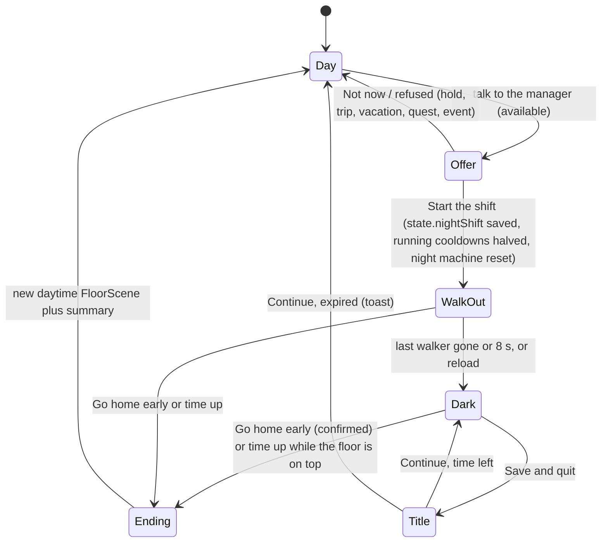

# Night Shift - Plan

## Goal Capsule

- **Objective:** On floors 5, 15, 25 and 35 a player can take a 10-minute night shift once a day: the office empties and goes dark and dramatic, and the machines work twice as fast. Afterwards they return to the normal daytime floor.
- **Means:** The shift is a mode of the ordinary `FloorScene`, driven by a pure `src/core/nightShift.js` and a saved `state.nightShift` (KTD1, KTD2).
- **Authority:** Requirements (R) win on product behaviour. KTDs win on mechanism. Units never override either.
- **Stop conditions:** Stop and ask Martin if either of these holds:
  - The pacing simulation with a daily night shift (U1) leaves its coffee-pacing bounds.
  - Making the HR rep walk out needs changes to floor generation, which would reshuffle floors.
- **Execution profile:** Browser game, vanilla ES modules, Bun 1.3. Pure core plus scene code, following the business-trip and vacation features. The C64 port is feature-frozen and not touched.
- **Who ships:** The implementing session. Commit and push only when Martin asks.

---

## Product Contract

### Summary

On the four night floors, the floor's first colleague becomes "Your Manager". When the player comes near, the manager teases a night shift, and talking to them offers it.

Accepting starts the shift:
- Every colleague and the HR rep walk out through the elevator.
- The floor goes dark, some ceiling lights flicker, and a darker music track plays.
- A 10-minute wall clock starts.

During the shift, station cooldowns are halved and the floor's coffee machine also brews every 2 minutes. The elevator only offers "Go home early". Going home early, or running out of time, brings the player back to the daytime floor with everyone there, plus a short summary.

### Problem Frame

Floors 5, 15, 25 and 35 are the empty slots in the special-level rhythm. Floor 10 and 30 have the business trip and floor 20 the vacation (`docs/special-events.md`).

Players who have a session to spare have nothing on these floors that changes the pace or the mood. A night shift fills those slots with a short, atmospheric burst of faster play. It reuses the loop players already know instead of adding a new map.

### Requirements

**Offer**
- R1. On floors 5, 15, 25 and 35, `fl.npcs[0]` takes the role "Your Manager".
  - When the player is within reach, the manager teases with a bubble.
  - Talking to the manager while the shift is available opens a dialog with "Start the shift" and "Not now".
- R2. One night shift per local day, shared by all four floors. It is free. After it, the manager on any night floor answers with after-lines.
- R3. The offer is refused, with a short reason, in any of these cases:
  - during a compliance hold, a business trip or a vacation;
  - while a floor quest or office event is running;
  - before the lobby check-in is done.

**The shift**
- R4. On accept, every colleague and the HR rep walk to the elevator and leave. Then the floor turns dark.
- R5. Darkness:
  - A dark overlay covers the floor.
  - A few ceiling lights flicker. The flicker is slow and does not strobe.
  - There is a soft pool of light around the player.
  - Markers, prompts, bubbles and the HUD stay readable.
- R6. A darker music track plays for the whole shift, including after returning from a mini-game.
- R7. The shift lasts 10 minutes of wall-clock time. A clock panel shows the time left.
- R8. During the shift:
  - Station tasks get half the normal cooldown.
  - Cooldowns already running on this floor when the shift starts are halved.
  - Tasks pay normal paperclips, XP and KPI stars.
- R9. The floor's night coffee machine is ready at the start of the shift and again every 2 minutes. Each brew gives the usual cups.
- R10. While the shift runs, none of these are available:
  - stand-ups, office events and the coffee-break chat;
  - HR (review, promotion and HR calls);
  - the terminal floor jump;
  - floor-quest stations, which are taped off.

  Desk, desk shop, curios and Stock Option skips stay available.

**Leaving**
- R11. The elevator asks "Go home early?". Confirming ends the shift.
- R12. When the time runs out, the shift ends once the player is back on the floor. A mini-game or dialog that is still open is never cut short.
- R13. Ending the shift, early or on time:
  - brings back the daytime floor with all colleagues;
  - shows a summary of tasks done, paperclips, stars and coffee brewed.
- R14. Resuming a career mid-shift:
  - If time is left, the player continues on the dark, empty floor.
  - If the shift has expired, it ends with a short toast and the daytime floor.

### Acceptance Examples

- AE1. Covers R2, R3.
  - **Given** the player finished a night shift on floor 5 today,
  - **when** they talk to the manager on floor 15,
  - **then** the manager gives an after-line and no offer.
- AE2. Covers R8.
  - **Given** a station on floor 15 with 6 minutes of cooldown left,
  - **when** the shift starts,
  - **then** it has 3 minutes left.
- AE3. Covers R12, R13.
  - **Given** the clock hits 0 while a mini-game is playing,
  - **when** the game ends,
  - **then** the task counts under night rules, and back on the floor the shift ends with the summary.
- AE4. Covers R14.
  - **Given** the player quit to the title with 4 minutes left,
  - **when** they continue the career 2 minutes later,
  - **then** the floor is dark and empty with 2 minutes left.

### Key Decisions

- **Once a day, shared by the four floors, free.** Like the vacation's daily leave. A once-per-floor rule, like the business trip, would allow only 4 shifts in a whole career. Governs R2.
- **Stars land on the floor where they are earned, as in the daytime.** They help promotion only when that floor is the player's highest. The offer text promises faster machines, not a promotion. Governs R1, R8.
- **Colleague-dependent systems switch off, not adapt.** Quests, HR, stand-ups, events and the chat simply close. Governs R10.

### Scope Boundaries

- No new map. It is the same floor with a night layer, unlike the client office or the hotel.
- No new currency and no economy changes beyond the halved cooldowns and the night brewer.
- No new badge. A "Night Owl" badge would need bumping the 37-badge count in `tests/achievements.test.js` and `src/index.html`.
- No C64 port, which is feature-frozen.
- No reminder when a shift ends while the tab is hidden. The wall clock keeps running, as on the trip.

---

## Planning Contract

### Key Technical Decisions

- KTD1. **The shift is a mode of `FloorScene`, not a subclass.**
  - `night` is a getter that reads `game.state.nightShift?.floor === this.floorNo` on every access, so the scene that accepts the shift switches at once and stays in night mode until `finishNight` clears the state. The constructor uses it only to skip spawning and appointing colleagues.
  - Reason: elevator rides, the exterior, the drive, debug helpers and terminal warps all build a plain `FloorScene`. A subclass would leave them showing a daytime floor while the shift's clock keeps running.
  - The title's Continue still gets a branch, to end shifts that have expired or belong to another floor (R14).
- KTD2. **Only the outcome is saved.**
  - `state.nightShift` holds `{ floor, endsAt, tasks, sp, stars, coffee }`, and `state.nightShifts` holds `{ day, count }`, with `newGame` defaults.
  - The walk-out is a temporary animation in the scene that accepted. A reload during it goes straight to the dark floor (R4, R14).
  - The constructor at night spawns no colleagues and no HR rep, and appoints no trip, boss, chat or stand-up colleague.
- KTD3. **Halving goes through `completeTask`.**
  - `completeTask` gains a `cooldownMult` option, used by a `completeNightTask` wrapper in `src/core/nightShift.js` (the pattern of `completeTripTask`) that also counts the summary.
  - `MinigameScene` gets a mode `'night'` that calls it.
  - On accept, `startNightShift` halves the remaining cooldowns of this floor's station tasks (R8).
  - Cooldowns earned at night stay halved after the shift. They are absolute timestamps, which is acceptable as a perk.
- KTD4. **The night machine has its own key.**
  - The night brewer is the floor's coffee machine under the key `coffee-machine-night` with `NIGHT_BREWER_S` = 120. This uses the `useCoffeeMachine` opts already used by the trip's `BREWER_KEY`.
  - The key is cleared on accept, so the first brew is ready at once.
  - The day machine's 15-minute cooldown is untouched.
  - `FloorScene.useCoffee()` and `brewerKey` switch on `night`. `src/scenes/statsDialog.js` must stop hard-coding the day key.
- KTD5. **The time-up ending waits until the floor is on top again.**
  - The floor checks `!nightActive` in `update` only when `game.top === this`, the pattern of `ClientOfficeScene`.
  - `startTask` re-checks and ends the shift instead of starting a task (R12).
- KTD6. **Constants live in `src/core/economy.js`:** `NIGHT_FLOORS = [5, 15, 25, 35]`, `NIGHT_SHIFT_S = 600`, `NIGHT_BREWER_S = 120` and `NIGHT_COOLDOWN_MULT = 0.5`.
- KTD7. **Walking out:**
  - Colleagues use `NpcBrain.leave(fl.spawn)`, the CEO-firing exit. `fl.spawn` is the elevator-lobby tile where arrivals step out of the elevator.
  - The HR rep gets a temporary `NpcBrain`, starting from a walkable tile next to the desk.
  - Each colleague who leaves normally plays a `ding`. This walk-out plays only one.
  - The lights go out when the last walker is gone, or after 8 s, whichever comes first. The slowest walkers need about 13–15 s, so when the 8 s cap fires anyone still walking is removed at once, without a ding.
- KTD8. **The darkness is one canvas pass after `view.render`.**
  - It runs before the markers, bubbles, prompt and HUD.
  - It is a dark fill with light pools cut out: one around the player, plus lamps at fixed spots taken from `fl.rooms` and the corridor, the same on every visit to the floor.
  - A few lamps flicker with a slow pattern, at most about 2 changes a second, never a strobe.
  - The compliance tape `drawHoldTape` takes a label so quest stations can say "CLOSED".

### High-Level Technical Design

### Sources

- Patterns:
  - `src/core/vacation.js` (status by day key, request, end, reset);
  - `src/core/trip.js` (`completeTripTask`, `BREWER_KEY`, `useBrewer`);
  - `src/scenes/clientOffice.js` (`finish(early)`, `drawClock`, the top-of-stack timer check, the `useCoffee`/`brewerKey` overrides).
- In `src/scenes/floorScene.js`:
  - `bossNpc`/`tripNpc` designation, `askVacation`, `startVacation`, `updateBossTease`;
  - `refreshStandup` pool, `drawHoldTape`, `drawHoldStrip`;
  - the compliance-hold gates in `interact`.
- `src/scenes/floorWorld.js`: `NpcBrain.leave`, `FloorView` (the `afterFloor` hook; the server-rack blink as animated-light precedent).
- `src/scenes/title.js` `continue()`: the `s.trip`/`s.vacation` resume branches.
- `src/data/music.js` `tech` as the darkest model for the new song.

---

## Implementation Units

### U1. Night shift rules (core)

- **Goal:** Pure rules for status, start, task completion, the night brewer and the end of the shift.
- **Requirements:** R2, R3, R7, R8, R9, R13; KTD2, KTD3, KTD4, KTD6.
- **Dependencies:** none.
- **Files:**
  - `src/core/nightShift.js` (new);
  - `src/core/economy.js`;
  - `src/core/state.js` (`newGame` defaults; `cooldownMult` option on `completeTask`);
  - `tests/nightShift.test.js` (new);
  - `tests/pacing.test.js` (night-shift variant).
- **Approach:**
  1. `nightStatus(s, floor, now)` returns `'none' | 'available' | 'today' | 'on' | 'blocked'`. Blocked covers a hold (`CD.onHold`), `s.trip`, `s.vacation` and `s.lobby !== 'done'`.
  2. `startNightShift(s, floor, now)` sets the day key and `s.nightShift`, halves this floor's remaining station cooldowns and clears the night brewer key.
  3. Add `completeNightTask` (tallies tasks, paperclips and stars), `useNightBrewer` (tallies coffee), `nightLeft`/`nightActive`, `endNightShift` (returns the summary and nulls the state) and `resetNight` for debugging.
- **Patterns to follow:** `src/core/vacation.js`, `src/core/trip.js`.
- **Test scenarios:**
  - Floor 5 at noon, a career past the lobby check-in: `available`. Floor 6: `none`.
  - After a shift on floor 5, floor 35 the same day: `today`. The next day: `available`. Covers AE1.
  - On hold, during a trip, on vacation, or with `lobby` `'checkin'`: `blocked`, and `startNightShift` refuses.
  - A station on the shift's floor with 6 min left: 3 min left after start. A station on another floor is unchanged. Covers AE2.
  - `completeNightTask` at night: the cooldown is half `stationCooldownMs`, stars go to `starsByFloor[floor]`, and the tally rises.
  - The night brewer: ready at start, refused 60 s later, ready at 120 s. Each brew adds the usual cups and counts in the tally. The day machine key is untouched.
  - `endNightShift` returns the tally and nulls `nightShift`. `nightActive` is false once `endsAt` has passed.
  - An old save without the new keys deserializes with the defaults.
- **Pacing:** `tests/pacing.test.js` gets a variant of its career simulation with a daily night shift on the nearest night floor: a 2-minute brewer for 10 minutes and half cooldowns during it. It must stay within the same coffee-pacing bounds.
- **Verification:** `bun test tests/nightShift.test.js` passes. `tests/economy.test.js` passes, and so does `tests/pacing.test.js` with the night-shift variant.

### U2. Night mode on the floor (offer, walk-out, gates, ending)

- **Goal:** `FloorScene` runs the whole shift loop on the floor where it was accepted.
- **Requirements:** R1–R4, R7–R14; KTD1, KTD2, KTD3, KTD4, KTD5, KTD7.
- **Dependencies:** U1.
- **Files:**
  - `src/scenes/floorScene.js`, `src/scenes/minigameScene.js`, `src/scenes/statsDialog.js`;
  - `src/data/nightShift.js` (new: teasers, offer, after-lines, refusals, summary text; ASCII only);
  - `tests/nightShiftScenes.test.js` (new).
- **Approach:**
  1. **Constructor and setup:**
     - Add the `night` getter.
     - At night, spawn no colleagues and no HR rep, and appoint no special colleagues.
     - On night floors in the daytime, appoint `nightBoss` = `fl.npcs[0]` with the role "Your Manager" and keep it out of the stand-up pool.
  2. **Offer:**
     - The tease reuses the `updateBossTease` shape and the shared `teaseT`.
     - `askNight` is a Dialog. Its text names the 10 minutes and the faster machines, says HR, quests and stand-ups are closed until morning, and that leaving early still uses today's shift. `startNight` applies the same guards as `startVacation`, then:
       - calls `startNightShift`;
       - clears the stand-up colleague and the HR call bubble;
       - starts the walk-out (KTD7) and the music;
       - sends `track('night_start', { floor })` and calls `saveNow`.
  3. **Gates:** `night` closes the events check, the stand-up toast and marker, the chat colleague, the HR desk ("HR has gone home."), `updateHrCall`, the promotion marker, the terminal and quest stations.
  4. **Tasks and coffee:**
     - `taskMode` is `'night'`, and `MinigameScene` calls `completeNightTask` in that mode.
     - `useCoffee` and `brewerKey` switch to the night brewer.
  5. **Ending:**
     - The elevator opens a confirm dialog. On confirm it calls `finishNight(true)`.
     - When time is up and the floor is on top, it calls `finishNight(false)`.
     - `finishNight` calls `endNightShift`, sends `track('night_end', {floor, sp, tasks, early})`, and calls `game.set(new FloorScene(game, floor, { arrival: 'elevator', nightSummary }))`. The new daytime scene opens one summary Dialog (tasks, paperclips, stars, coffee brewed, OK) for both endings.
- **Patterns to follow:** `askVacation`/`startVacation`, `fire(n)`, `ClientOfficeScene.finish`, the compliance-hold gates in `interact` and `drawMarkers`.
- **Test scenarios:**
  - On floor 15 the manager has the role "Your Manager". Talking to them opens the offer, and "Start the shift" sets `state.nightShift`.
  - After accepting and ticking 9 s (past the 8 s cap), `scene.npcs` is empty and `hrRep` is gone. Only one `ding` played.
  - The offer is refused while a quest or an event runs, and on hold.
  - At night these are blocked: the HR desk gives a toast and no review, the terminal is blocked, a quest station opens no FloorQuest, and no event starts in a long tick.
  - A night task completes with half the cooldown, and the coffee machine gives cups at 0 s and again after 120 s.
  - The elevator opens the "Go home early" dialog. Confirming puts a daytime `FloorScene` on top with colleagues, `nightShift` is null and a summary is shown.
  - Time runs out while a `MinigameScene` is on top: nothing ends. After the game finishes and pops, the next update ends the shift and the night task counts in the summary. Covers AE3.
  - Constructing a `FloorScene` for the night floor from another path (as `ElevatorRide` does) gives the dark, empty floor.
- **Verification:** The new scene tests pass, and the trip, vacation and conduct scene tests still pass.

### U3. Night look

- **Goal:** Darkness, the flickering lamps, the player's light, "CLOSED" tape and the clock panel.
- **Requirements:** R5, R7, R10; KTD8.
- **Dependencies:** U2.
- **Files:**
  - `src/scenes/floorScene.js` (or a small `src/scenes/nightLights.js` if the drawing code is large);
  - `tests/nightShiftScenes.test.js`.
- **Approach:**
  - The lamp layout is a pure function of the floor, so it can be tested.
  - Draw an offscreen dark layer with radial cut-outs, composited once per frame at the logical 480×270.
  - The clock panel mirrors `ClientOfficeScene.drawClock`.
  - `drawHoldTape` takes a label argument.
  - During the walk-out, the darkness fades in from 0 to full.
- **Patterns to follow:** `drawClock` in `src/scenes/clientOffice.js`, `drawHoldTape`, and the cityscape `night` palette.
- **Test scenarios:**
  - The lamp layout for floor 25 is the same on two calls and has at least 4 lamps inside walkable rooms.
  - The flicker function, sampled over 10 s, changes state no more than about 2 times a second.
  - Rendering the night floor to the mock canvas does not throw. Neither does the walk-out frame, half dark.
- **Verification:**
  - A visual check on a dev server on another port than 5317, for example 5391 (not 3000):
    - The floor is dark, the lamps flicker gently, and the player stays lit.
    - Markers, prompts and the clock are readable.
  - Also check it in the portrait dock.

### U4. Night music

- **Goal:** A darker, more dramatic tracker song for the shift.
- **Requirements:** R6.
- **Dependencies:** U2.
- **Files:**
  - `src/data/music.js`;
  - `src/scenes/floorScene.js` (`enter`/`resume` pick the night track when `night`);
  - `tests/audio.test.js`.
- **Approach:**
  - A new `nightshift` song in the tracker format: minor key, slower and heavier than `tech`, a sparse lead and a pulsing bass.
  - It uses only `CHORD_QUALITIES` that already exist.
  - `MinigameScene` keeps `'minigame'` during the shift.
- **Test scenarios:**
  - `tests/audio.test.js` compiles `nightshift` with 16 valid steps per bar.
  - `FloorScene.resume()` at night plays `nightshift`. In the daytime it plays the department track.
- **Verification:** Listen on the dev server. The track loops cleanly and is clearly darker than the floor music.

### U5. Resume, debug helpers

- **Goal:** Continuing a career mid-shift does the right thing, and the shift is easy to test from the console.
- **Requirements:** R14.
- **Dependencies:** U2.
- **Files:**
  - `src/scenes/title.js`;
  - `src/debug.js`;
  - `tests/nightShiftScenes.test.js`.
- **Approach:**
  - `continue()` gets a `s.nightShift` branch:
    - active, on the saved floor: the dark floor;
    - expired, or `s.floor !== nightShift.floor`: `endNightShift`, a toast with the tally, then the daytime floor.
  - `__night()` opens the offer on the nearest night floor at or below `maxFloor`, free, resetting today.
  - `__night(15)` rides to floor 15 first.
  - `__night('dark')` skips straight into the shift, and `__night(15, 'dark')` does both (floor first, then mode, as `__trip(10, 'client')` does).
- **Patterns to follow:** the `s.trip`/`s.vacation` branches in `continue()`, `__vacation` in `src/debug.js`.
- **Test scenarios:**
  - Save mid-shift with 4 min left, advance the clock 2 min and continue: a dark `FloorScene` with about 2 min left. Covers AE4.
  - Save mid-shift, advance the clock 11 min and continue: a daytime floor with colleagues, `nightShift` null, and a toast.
  - `tests/devOnly.test.js` still shows `__night` is absent from the production build.
- **Verification:** The scene tests pass, and the debug helpers work on the dev server.

### U6. Documentation and spec

- **Goal:** The guide, crawler files and project docs describe the night shift.
- **Requirements:** all, as documentation.
- **Dependencies:** U1–U5.
- **Files:**
  - `CLAUDE.md` (a Night shift bullet like Business trip/Vacation; analytics `night_start {floor}` and `night_end {floor, sp, tasks, early}`; console `__night`);
  - `public/how-to-play/index.html` (a section plus a TOC entry; screenshot `img/night-shift.png`);
  - `public/llms.txt`;
  - `src/index.html` (sr-only feature list);
  - `docs/special-events.md` (fill in floors 05/15/25/35);
  - `docs/superpowers/specs/2026-10-14-night-shift-design.md` (new; every special level has one).
- **Approach:** Match the wording and density of the trip and vacation entries. `public/privacy/index.html` needs no change, because the new analytics events carry only game data.
- **Test expectation:** none, this is documentation only.
- **Verification:** The guide's facts match `src/core/economy.js`: floors, 10 minutes, half cooldowns, 2-minute brewer.

---

## Verification Contract

| Gate | Command / check | Proves |
|---|---|---|
| Unit and scene tests | `bun test` (the whole suite; focused: `bun test tests/nightShift.test.js tests/nightShiftScenes.test.js tests/audio.test.js`) | Rules, scene flow, music |
| Economy guards | `tests/economy.test.js`, and `tests/pacing.test.js` with its night-shift variant, within `bun test` | No balance regression, night shift included |
| Font | `tests/font.test.js` within `bun test` | New text is ASCII with glyphs |
| Dev-only helpers | `tests/devOnly.test.js` | `__night` is not in production |
| Build | `bun run build` | The bundle builds |
| Visual | Dev server on port 5391 (never 3000; don't touch Martin's :5317 save): `__night(15, 'dark')` | Darkness, flicker, light, clock, music |

## Definition of Done

- Every unit's tests pass and the full `bun test` suite is green.
- A visual check shows the walk-out, the dark floor with gentle flicker, a readable HUD, the "Go home early" ending and the summary.
- The docs listed in U6 are updated.
- No leftover experimental code, no stray screenshots in the repo root, and no files from other sessions (such as `tunes.mp3`) in the commit.
